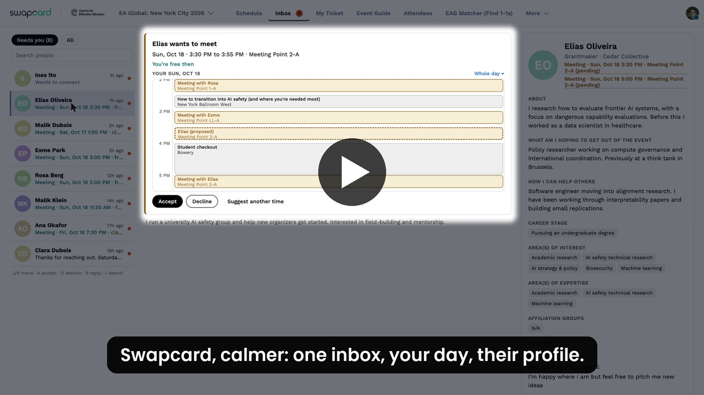

# Calmer Card

A Chrome extension that makes Swapcard's attendee app calmer: one calendar for your schedule, one inbox for requests and chats, and profiles that open beside what you're doing.

[](https://github.com/Julian-Moncarz/fixing-swapcard/releases/download/v0.1.1/calmer-card-demo.mp4)

*Click to watch the 1:38 demo. Attendee names, photos and bios in it are made up.*

## Install

**Chrome Web Store:** [Calmer Card](https://chromewebstore.google.com/detail/ngpmfdeipdeookpopebpnfpaoocaalfh) *(in review; updates install automatically once it's live)*.

**From GitHub, today:**

1. [Download calmercard.zip](https://github.com/Julian-Moncarz/fixing-swapcard/releases/latest/download/calmercard.zip) and unzip it somewhere permanent.
2. Open `chrome://extensions`, turn on **Developer mode**, click **Load unpacked**, and pick the `calmercard` folder.
3. Open your event on [app.swapcard.com](https://app.swapcard.com).

To update, unzip the new release over the folder and click ↻ on the extension. Works in Chrome, Edge, Brave and Arc.

## Feedback

Click **Give feedback on this UI** (bottom right) to open a pre-filled GitHub issue (your comment, the page, the version, and any Swapcard hooks that found nothing), with an optional screenshot you can mark up and blur first. Pull requests are welcome: see [CONTRIBUTING.md](CONTRIBUTING.md). [PAIN-POINTS.md](PAIN-POINTS.md) lists the stock Swapcard frustrations this fixes.

## How it works

- Content scripts run in the page's main world so they can reach Swapcard's React tree and reuse Swapcard's own calendar, Messages page, Meet modal and theme.
- Data goes through **Swapcard's own Apollo client** (found by walking React fibers), so you stay signed in as yourself and their UI stays in sync. Queries are our own text (`src/data.js`), not their persisted-query hashes.
- Swapcard's CSP forbids framing its pages, so the side panel renders their data itself.
- When Swapcard changes something we hook into, that feature switches off and stock Swapcard shows through.

[CATALOG.md](CATALOG.md) maps Swapcard's screens, components and GraphQL operations.

| File | Role |
|---|---|
| `src/core.js` | Hooks: webpack require, gql tag, Apollo clients, theme, route and DOM events, helpers |
| `src/data.js` | Queries and mutations |
| `src/ui.js` | Formatting, toasts, hover card, day grid |
| `src/nav.js` | One Schedule tab, redirects, hides the bell and chat icons |
| `src/calendar.js` | Grey sessions, hiding, day view in My Schedule's calendar |
| `src/drawer.js` | Side panel and link interception |
| `src/inbox.js` | Inbox nav item, requests, profile column |
| `src/booking.js` | Calendar picker for the side panel and Swapcard's Meet modal |
| `src/feedback.js` | Feedback button and screenshot markup |
| `src/boot.js` | Startup, page classes, cruft removal |

## Development

```bash
node scripts/build-bundle.mjs
```

Builds `dist/calmercard.bundle.js` (all CSS and JS in one file). `scripts/dev-server.py` serves it on `127.0.0.1:8765` and rebuilds on each request. With the extension disabled in `chrome://extensions` (and `cc:off` not set), load the latest code into a Swapcard tab with:

```js
const t = await (await fetch('http://127.0.0.1:8765/calmercard.bundle.js', { cache: 'no-store' })).text();
(0, eval)(t);
```

- Turn the extension off for one browser (to compare with stock Swapcard): `localStorage.setItem('cc:off', '1')`, then reload. Remove the key to turn it back on. Note the dev bundle respects this switch too.
- `scripts/demo-anonymize.js` swaps attendees' names, photos and bios for fake ones, for screenshots and recordings (paste it into the console). `scripts/demo/` renders the demo video.
- Debug logging: `localStorage.setItem('cc:debug', '1')`.
- `bash scripts/package.sh` builds `dist/calmercard.zip` (GitHub release) and `dist/calmercard-store.zip` (Chrome Web Store).
